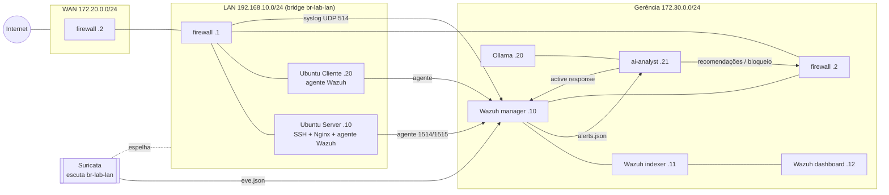

# Laboratório SOC — Monitoramento Inteligente de Redes

Ambiente em Docker do projeto de Extensão Universitária II / TCC
*Monitoramento Inteligente de Redes para Detecção de Ameaças e Anomalias*.
Ele reúne firewall, LAN com servidor e cliente, sensor IDS (Suricata), SIEM (Wazuh) e
uma IA local (Ollama) que analisa os alertas, aprende com o histórico e recomenda
bloqueios.

> Uso exclusivo em laboratório isolado. Todos os testes são feitos contra as
> próprias máquinas do lab.

## Arquitetura



| Componente | Imagem | IP(s) | Função |
|---|---|---|---|
| firewall | `pfsense/firewall` (Debian + nftables) | WAN 172.20.0.2 · LAN 192.168.10.1 · MGMT 172.30.0.2 | roteador, NAT, regras default-deny, logs via syslog, API de bloqueio |
| server | `lan/` (Ubuntu 24.04, ROLE=server) | 192.168.10.10 | SSH, Nginx, agente Wazuh (FIM em /etc e /var/www) |
| cliente | `lan/` (Ubuntu 24.04, ROLE=cliente) | 192.168.10.20 | estação de usuário e origem dos testes, agente Wazuh |
| suricata | `jasonish/suricata:7.0` | rede do host (bridge da LAN) | IDS com ET Open + regras locais, `eve.json` |
| wazuh.* | `wazuh/wazuh-*:4.14.10` (single-node oficial) | 172.30.0.10–12 | manager, indexer, dashboard |
| ollama | `ollama/ollama` | 172.30.0.20 | LLM local (DeepSeek-R1 8B por padrão) |
| ai-analyst | `ia/` (Python) | 172.30.0.21 | triagem, análise, memória (RAG), prevenção, saúde |

Decisões e desvios:
- **Firewall:** o pfSense não roda em Docker. Foi usada a opção (c), um container
  nftables replicando as regras. Ver [`pfsense/README.md`](pfsense/README.md).
- **Sensor:** o Suricata escuta a bridge `br-lab-lan` em modo promíscuo, no namespace de
  rede do host. No namespace do firewall ele só veria o tráfego roteado. Cliente↔Server
  na mesma LAN é comutado pela bridge e nunca passa pelo firewall, então os testes de
  varredura e força bruta ficariam invisíveis.
- **Retorno Wazuh→LAN:** o container `wazuh-route` só adiciona ao namespace do manager
  a rota `192.168.10.0/24 via 172.30.0.2`. Assim os agentes aparecem com o IP real.

## Como usar (Windows + Docker Desktop)

Pré-requisitos: Docker Desktop (WSL 2), cerca de 16 GB de RAM e cerca de 25 GB livres.
Na pasta do projeto, no PowerShell:

```powershell
powershell -ExecutionPolicy Bypass -File .\lab.ps1 preparar   # .env, certificados, imagens
powershell -ExecutionPolicy Bypass -File .\lab.ps1 fase1      # firewall + LAN: ping, rotas, internet
powershell -ExecutionPolicy Bypass -File .\lab.ps1 fase2      # regras: liberado x bloqueado
powershell -ExecutionPolicy Bypass -File .\lab.ps1 fase3      # Wazuh + Suricata
powershell -ExecutionPolicy Bypass -File .\lab.ps1 fase5      # Ollama + ai-analyst
powershell -ExecutionPolicy Bypass -File .\lab.ps1 teste -Id 3   # testes 1..6
powershell -ExecutionPolicy Bypass -File .\lab.ps1 prints     # capturas em prints/
```

Todas as saídas ficam em `testes/saidas/`. As evidências de cada teste ficam em
`testes/T<n>.md`. A IA escreve em `ia/recomendacoes.md`, `ia/incidentes.md` e
`ia/saude.md`.

| Acesso | Endereço | Credenciais |
|---|---|---|
| Wazuh dashboard | https://localhost:8443 | `.env`: `INDEXER_USERNAME` / `INDEXER_PASSWORD` |
| Wazuh API | https://localhost:55000 | `.env`: `API_USERNAME` / `API_PASSWORD` |
| Ollama | http://localhost:11435 | — |

As portas ficam publicadas só em `127.0.0.1`, ou seja, não ficam expostas para a sua
rede.

## IA: como funciona

1. **Leitura:** o ai-analyst acompanha `alerts.json` do Wazuh (volume somente-leitura)
   a cada `AI_POLL_SECONDS`.
2. **Triagem:**
   - Alertas com nível ≥ `AI_MIN_LEVEL` (7) viram incidente.
   - Alertas menores da mesma origem são agrupados a partir de `AI_GROUP_THRESHOLD` (10).
   - Rajadas viram um único incidente, para não chamar o LLM centenas de vezes.
3. **Análise:** o LLM responde em JSON validado com classificação, gravidade, causa
   provável, MITRE ATT&CK, ação recomendada e sugestão de regra.
4. **Memória (RAG):** SQLite guarda cada incidente, a análise, a ação e um embedding
   (`nomic-embed-text`). A cada novo caso, entram no prompt os incidentes anteriores da
   mesma origem (reincidência) e os casos semanticamente parecidos.
5. **Prevenção:** com `AUTO_BLOCK=false` (padrão), as ações só são gravadas em
   `ia/recomendacoes.md`, com os comandos para você aprovar. Com `AUTO_BLOCK=true`, o
   bloqueio é aplicado somente se todas as condições valerem:
   - o IP é do lab;
   - o IP não está na lista de protegidos;
   - houve reincidência ou a gravidade é alta/crítica;
   - a IA não classificou como falso positivo.

   O bloqueio é feito na blocklist do firewall e via active response `firewall-drop`
   no agente atacado.
6. **Saúde:** a cada `AI_HEALTH_INTERVAL_S`, gera `ia/saude.md` com:
   - serviços respondendo;
   - agentes conectados;
   - Suricata gerando eventos;
   - modelo carregado.

**DeepSeek-R1 × Hermes 3:**
- **DeepSeek-R1 (padrão):** a tarefa é analítica (correlacionar alertas, inferir causa,
  mapear ATT&CK) e roda de forma assíncrona. Por isso compensa um modelo de raciocínio,
  mesmo mais lento. A saída em JSON é garantida pelo *structured output* do Ollama, o
  que reduz a fraqueza de formato desse tipo de modelo.
- **Hermes 3:** responde mais rápido e segue bem instruções e formatos. É a alternativa
  para hardware fraco. Basta mudar `LLM_MODEL` no `.env`.
- **Comparação:** cada análise guarda o prompt em `ia/analises/`, então os dois modelos
  podem ser comparados nos mesmos incidentes.

## Ambiente experimental (demonstração)

A pasta `simulacao/` recria a mesma topologia com máquinas simuladas (namespaces Linux)
e situações hipotéticas. Foi usada para gerar as evidências e os prints do Checkpoint 4.
Veja [`simulacao/README.md`](simulacao/README.md).

## Estrutura

```
docker-compose.yml   .env.example   lab.ps1   PROGRESSO.md
pfsense/   firewall nftables (Dockerfile, regras, ulogd2, rsyslog, API de bloqueio)
lan/       imagem do Ubuntu Server/Cliente com agente Wazuh
suricata/  entrypoint do sensor e regras locais
wazuh/     arquivos oficiais single-node + config/custom (decoders, regras, agent.conf)
ia/        ai-analyst (Python) + testes; saídas: recomendacoes.md, incidentes.md, saude.md
testes/    evidências por teste (T1..T6) e saídas de terminal
prints/    capturas de tela numeradas
relatorio/ Checkpoint 4 (docx/pdf)
scripts/   diagnóstico do host e captura de prints
simulacao/ ambiente experimental (máquinas simuladas, emulador do SIEM, eventos hipotéticos)
```
